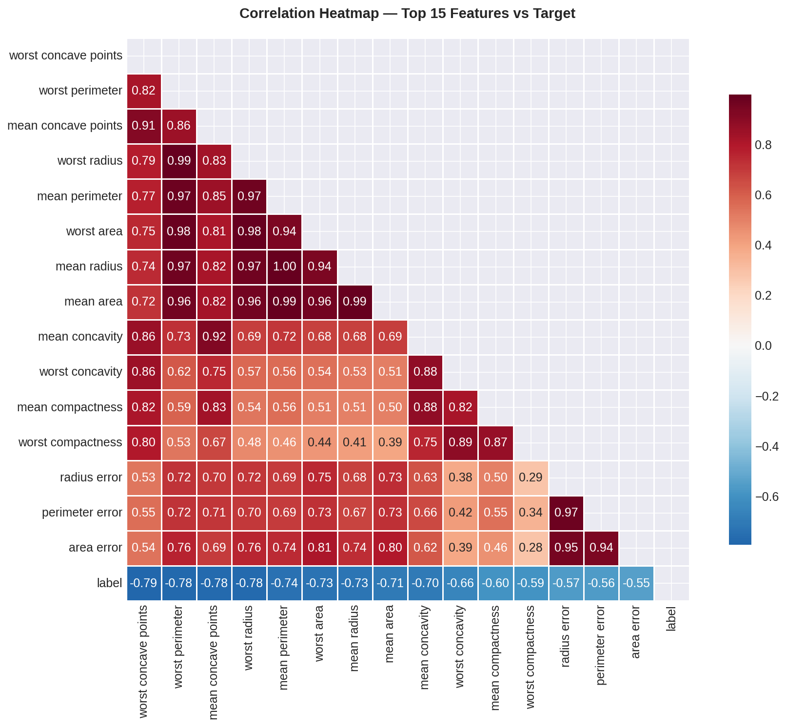
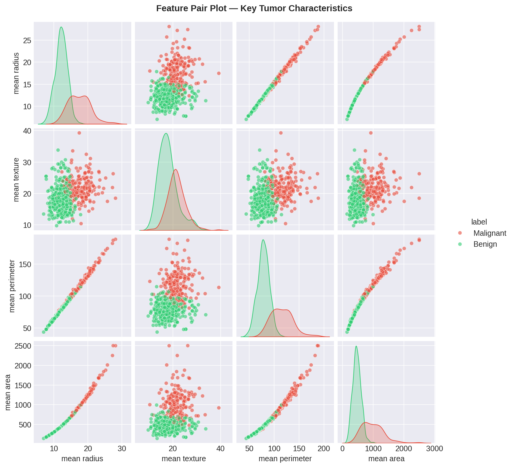
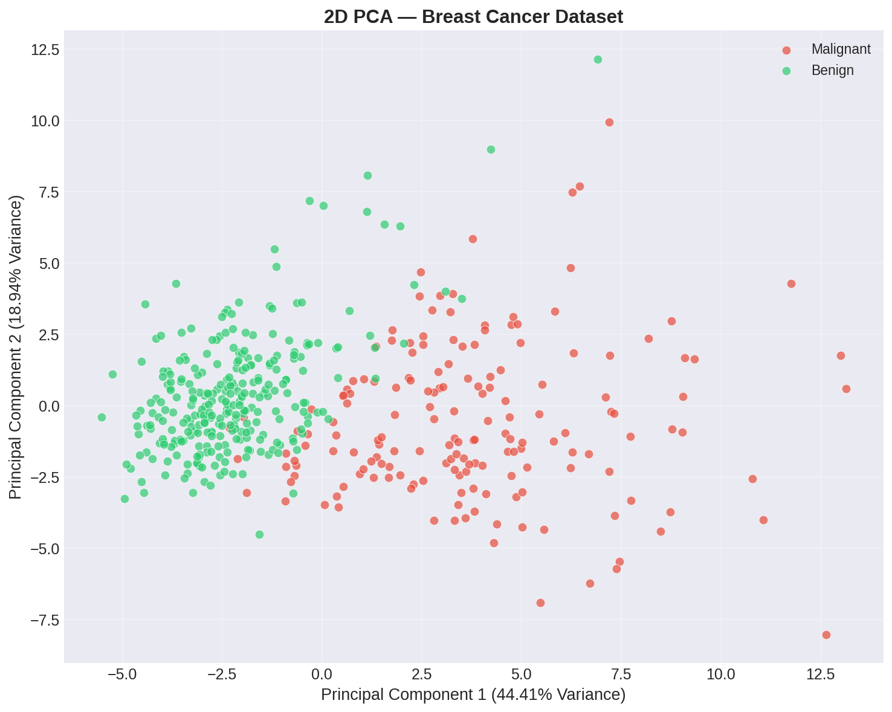
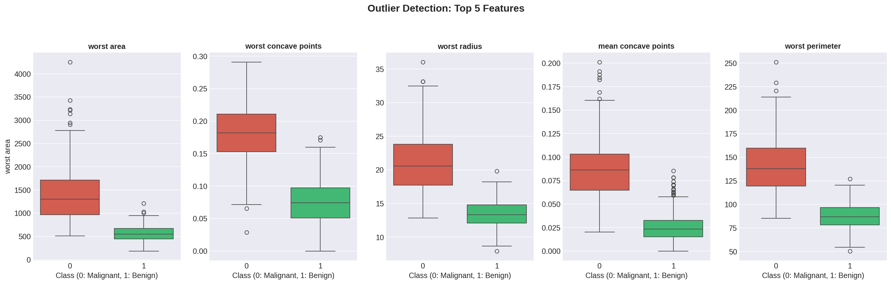
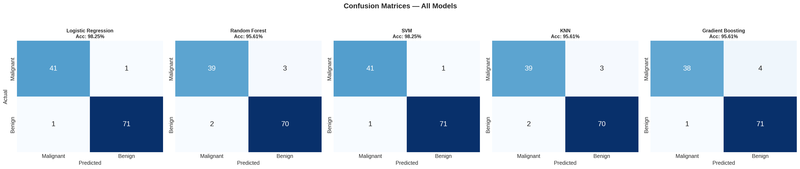
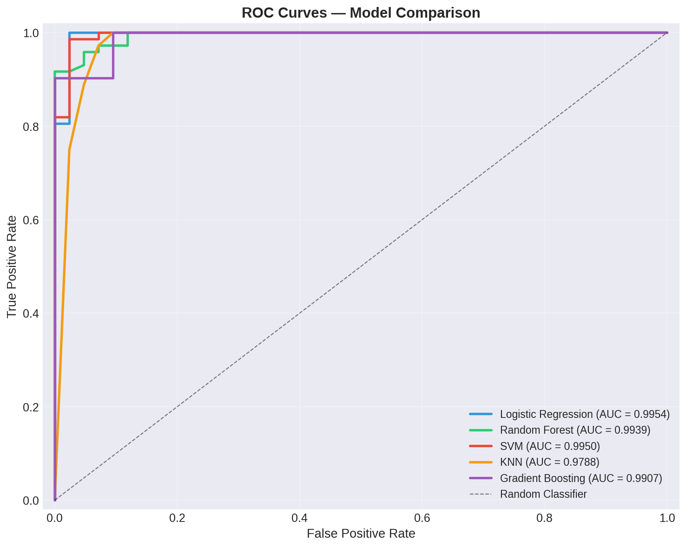
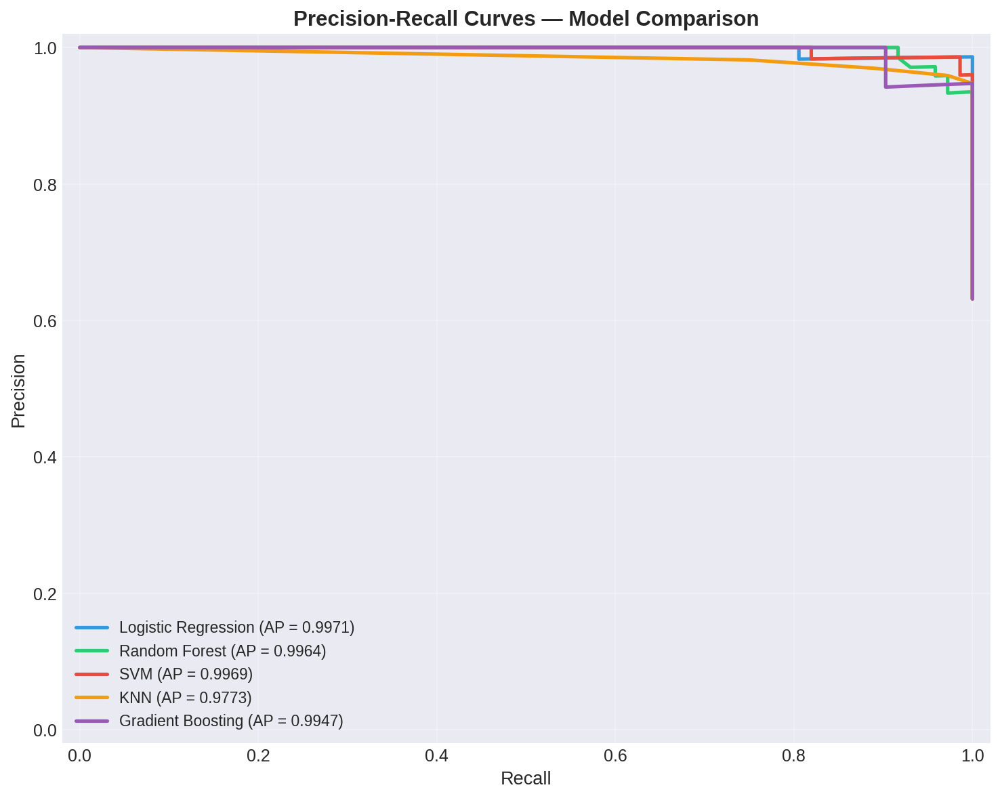
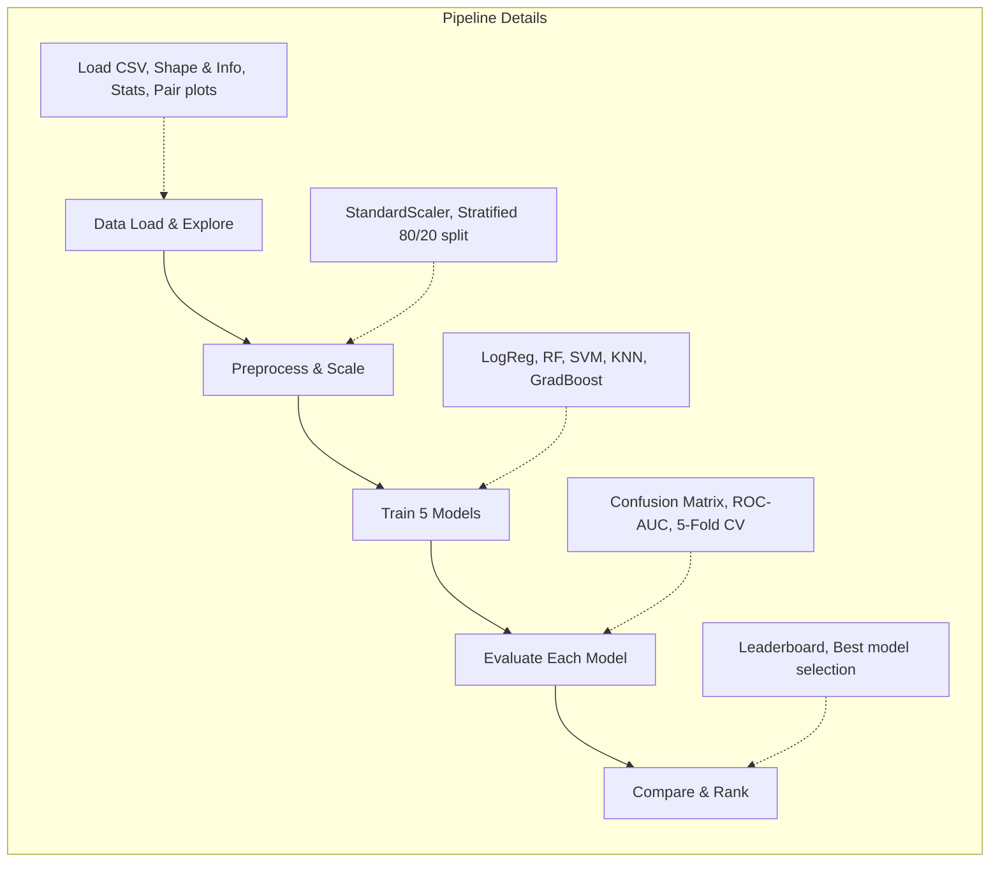

# 🧬 Breast Cancer Prediction Engine

### Machine Learning-Powered Diagnostic Classification System

[](https://python.org)
[](https://scikit-learn.org)
[](https://pandas.pydata.org)
[](https://jupyter.org)

An end-to-end machine learning pipeline that classifies breast tumors as **benign** or **malignant** with **98.25% accuracy**, comparing five machine learning models with comprehensive evaluation metrics.

---

[Features](#-features) · [Models](#-models-trained) · [Results](#-results) · [Getting Started](#-getting-started) · [Project Structure](#-project-structure)

---

## 🎯 Problem Statement

Breast cancer is one of the most common cancers affecting women globally. Early identification and accurate classification of breast tumors are important aspects of medical research.

This project implements a **binary classification system** using machine learning techniques to predict whether a breast tumor is:

| Class | Label | Description |
|:-----:|:-----:|:------------|
| `0` | **Malignant** | Cancerous tumor |
| `1` | **Benign** | Non-cancerous tumor |

The system evaluates multiple machine learning models to compare their classification performance using different evaluation metrics.

## ✨ Features

- 🔬 **Data Exploration & Profiling** — Statistical analysis of 30 tumor characteristics.
- 📊 **Visual Analytics** — Pair plots, correlation heatmaps, and class distribution charts.
- 🧹 **Data Preprocessing** — Feature normalization with StandardScaler and stratified train/test splitting.
- 🤖 **5 ML Models** — Logistic Regression, Random Forest, SVM, KNN, and Gradient Boosting.
- 📈 **Comprehensive Evaluation** — Confusion matrices, ROC-AUC curves, precision-recall curves, and classification reports.
- 🔄 **Cross-Validation** — 5-fold stratified cross-validation for performance estimation.

---

## 🧠 Models Trained

| # | Model | Type | Key Strength |
|:-:|:------|:-----|:-------------|
| 1 | **Logistic Regression** | Linear | Interpretable, fast, strong baseline |
| 2 | **Random Forest** | Ensemble | Handles non-linear patterns, feature importance |
| 3 | **Support Vector Machine** | Kernel-based | Effective in high-dimensional spaces |
| 4 | **K-Nearest Neighbors** | Instance-based | Intuitive, distance-based classification |
| 5 | **Gradient Boosting** | Boosted Ensemble | Sequential error correction |

---

## 📊 Dataset

**Source:** [Breast Cancer Wisconsin (Diagnostic) Dataset](https://www.kaggle.com/c/breast-cancer-classification) — UCI Machine Learning Repository via Kaggle.

| Property | Value |
|:---------|:------|
| Samples | 569 |
| Features | 30 numeric predictive attributes |
| Classes | 2 (Malignant / Benign) |
| Missing Values | None |

### Key Features

The dataset describes characteristics of cell nuclei present in digitized images of fine needle aspirate (FNA) of breast masses.

- **Geometry** — Radius, perimeter, area, compactness, and concavity.
- **Texture** — Texture, smoothness, symmetry, and fractal dimension.
- Each feature includes **mean**, **standard error**, and **worst** (largest) values.

### Data Visualization

<div align="center">

| Class Distribution | Feature Correlation |
|:------------------:|:-------------------:|
|  |  |

| Feature Pair Plot |
|:----------------:|
|  |

</div>

---

### Advanced Feature Engineering

<div align="center">

| PCA (2D Projection) | Feature Importance |
|:------------------:|:------------------:|
|  |  |

| Outlier Detection (Top 5 Features) |
|:----------------------------------:|
|  |

</div>

---

## 🏆 Results

### Model Comparison Leaderboard

| Model | Test Accuracy | Precision | Recall | F1-Score | AUC |
|:------|:------------:|:---------:|:------:|:--------:|:---:|
| **🥇 Logistic Regression** | **98.25%** | 98.61% | 98.61% | 98.61% | 0.9954 |
| **🥇 SVM** | **98.25%** | 98.61% | 98.61% | 98.61% | 0.9950 |
| Random Forest | 95.61% | 95.89% | 97.22% | 96.55% | 0.9939 |
| KNN | 95.61% | 95.89% | 97.22% | 96.55% | 0.9788 |
| Gradient Boosting | 95.61% | 94.67% | 98.61% | 96.60% | 0.9907 |

### Confusion Matrices

<div align="center">



</div>

### ROC-AUC Curves

<div align="center">



</div>

### Precision-Recall Curves

<div align="center">



</div>

### Cross-Validation (5-Fold Stratified)

<div align="center">


</div>

### Model Performance Comparison

<div align="center">


</div>

> **Key Insight:** Logistic Regression and SVM achieve the highest test accuracy (98.25%), with one false positive and one false negative each, according to the reported evaluation results.

---

## 🚀 Getting Started

### Prerequisites

- Python 3.10 or higher
- pip (Python package manager)

### Installation

```bash
# Clone the repository
git clone https://github.com/adityawork365-commits/Breast_Cancer_Prediction_Engine.git

# Navigate to the project directory
cd Breast_Cancer_Prediction_Engine

# Create a virtual environment
python -m venv venv

# Activate the virtual environment (Windows)
venv\Scripts\activate

# Activate the virtual environment (macOS/Linux)
source venv/bin/activate

# Install dependencies
pip install -r requirements.txt
```

### Run the Notebook

```bash
jupyter notebook notebooks/breast_cancer_prediction.ipynb
```

### Run the Web App (Streamlit)

```bash
streamlit run app.py
```

---

## 📁 Project Structure

```text
Breast_Cancer_Prediction_Engine/
│
├── notebooks/
│   └── breast_cancer_prediction.ipynb
│
├── data/
│   └── data.csv
│
├── images/
│   ├── class_distribution.png
│   ├── correlation_heatmap.png
│   ├── pairplot.png
│   ├── confusion_matrices.png
│   ├── roc_curves.png
│   ├── precision_recall_curves.png
│   ├── cross_validation.png
│   └── model_comparison.png
│
├── requirements.txt
├── .gitignore
└── README.md
```

---

## 🛠️ Tech Stack

| Technology | Purpose |
|:-----------|:--------|
| **NumPy** | Numerical computation |
| **Pandas** | Data manipulation and analysis |
| **Scikit-Learn** | ML models, metrics, and preprocessing |
| **Seaborn** | Statistical data visualization |
| **Matplotlib** | Plotting and charting |
| **Streamlit** | Web application framework |

---

## 📐 Methodology

The project follows a structured machine learning workflow:



---

## 🔮 Future Improvements

- [ ] Enhance the Streamlit web application for interactive predictions.
- [ ] Add PCA visualization (2D/3D).
- [ ] Improve feature importance ranking with Random Forest.
- [ ] Hyperparameter tuning with GridSearchCV.
- [ ] Docker containerization and cloud deployment.

---

## 🙏 Acknowledgments

- **Dataset:** [UCI Machine Learning Repository](https://archive.ics.uci.edu/dataset/17/breast+cancer+wisconsin+diagnostic) via Kaggle.
- **Inspiration:** Research on machine learning applications in computer-aided breast cancer classification.
- **Libraries:** Thanks to the developers and maintainers of the open-source libraries used in this project.

---

## 👨‍💻 Author

**Aditya Gour**

- GitHub: [@adityawork365-commits](https://github.com/adityawork365-commits)

Project customization and maintenance by Aditya Gour.

---

**Note:** This project is intended for educational and research purposes only. It is not a clinically validated diagnostic tool and must not be used as a substitute for professional medical advice or diagnosis.

---

⭐ If you find this project useful, consider giving the repository a star!
