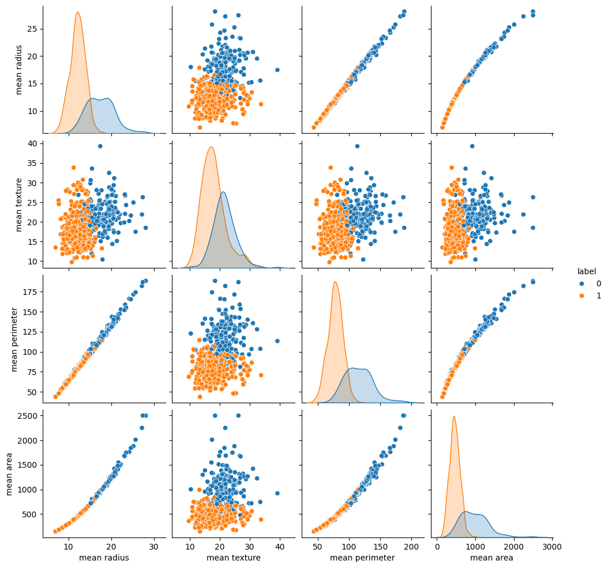

<div align="center">

# 🧬 Breast Cancer Prediction Engine

### Machine Learning-Powered Diagnostic Classification System

[](https://python.org)
[](https://scikit-learn.org)
[](https://pandas.pydata.org)
[](https://jupyter.org)
[](LICENSE)

*An end-to-end machine learning pipeline that classifies breast tumors as **benign** or **malignant** with **92.98% accuracy**, built to assist early-stage cancer diagnosis.*

---

[Features](#-features) · [Dataset](#-dataset) · [Results](#-results) · [Getting Started](#-getting-started) · [Project Structure](#-project-structure)

</div>

---

## 🎯 Problem Statement

Breast cancer is one of the most common cancers affecting women globally. Traditional diagnostic methods rely on subjective visual inspections, which can lead to diagnostic errors. Research shows that machine learning can improve diagnostic accuracy from **79.97%** (experienced physicians) to over **91%** — providing a critical second opinion for clinicians.

This project builds a **binary classification model** that predicts whether a breast tumor is:

| Class | Label | Description |
|:-----:|:-----:|:------------|
| `0` | **Malignant** | Cancerous — requires immediate medical intervention |
| `1` | **Benign** | Non-cancerous — lower immediate risk |

---

## ✨ Features

- 🔬 **Data Exploration & Profiling** — Statistical analysis of 30 tumor characteristics
- 📊 **Visual Analytics** — Distribution plots, correlation heatmaps, and feature analysis
- 🧹 **Data Preprocessing** — Missing value handling, feature normalization, and train/test splitting
- 🤖 **Logistic Regression Model** — Optimized binary classifier with interpretable coefficients
- 📈 **Performance Evaluation** — Accuracy metrics on both training and unseen test data

---

## 📊 Dataset

**Source:** [Breast Cancer Wisconsin (Diagnostic) Dataset](https://www.kaggle.com/c/breast-cancer-classification) — UCI Machine Learning Repository via Kaggle

| Property | Value |
|:---------|:------|
| Samples | 569 |
| Features | 30 numeric predictive attributes |
| Classes | 2 (Malignant / Benign) |
| Missing Values | None |

### Key Features

The dataset describes characteristics of cell nuclei present in digitized images of fine needle aspirate (FNA) of breast masses:

- **Geometry** — radius, perimeter, area, compactness, concavity
- **Texture** — texture, smoothness, symmetry, fractal dimension
- Each feature has **mean**, **standard error**, and **worst** (largest) values

### Data Visualization

<div align="center">

| Raw Data Overview | Feature Distribution |
|:-:|:-:|
|  |  |

</div>

---

## 🏆 Results

The Logistic Regression model achieves strong generalization performance:

| Metric | Score |
|:-------|:-----:|
| **Training Accuracy** | 94.73% |
| **Test Accuracy** | **92.98%** |

> The minimal gap between training and test accuracy indicates the model generalizes well to unseen data without overfitting.

---

## 🚀 Getting Started

### Prerequisites

- Python 3.10 or higher
- pip (Python package manager)

### Installation

```bash
# Clone the repository
git clone https://github.com/game-ale/Breast_Cancer_Prediction_Engine.git
cd Breast_Cancer_Prediction_Engine

# Create a virtual environment (recommended)
python -m venv venv
source venv/bin/activate  # On Windows: venv\Scripts\activate

# Install dependencies
pip install -r requirements.txt
```

### Run the Notebook

```bash
jupyter notebook notebooks/breast_cancer_prediction.ipynb
```

---

## 📁 Project Structure

```
Breast_Cancer_Prediction_Engine/
├── 📓 notebooks/
│   └── breast_cancer_prediction.ipynb   # Full ML pipeline notebook
├── 📊 data/
│   └── data.csv                         # Wisconsin Diagnostic Dataset
├── 🖼️ images/
│   ├── Screenshot 2024-09-28 085237.png # Raw data preview
│   └── Visualization.png               # Feature distribution plots
├── 📋 requirements.txt                  # Python dependencies
├── 📄 LICENSE                           # MIT License
├── 🚫 .gitignore                        # Git ignore rules
└── 📖 README.md                         # Project documentation
```

---

## 🛠️ Tech Stack

| Technology | Purpose |
|:-----------|:--------|
| **NumPy** | Numerical computation |
| **Pandas** | Data manipulation & analysis |
| **Scikit-Learn** | ML model training & evaluation |
| **Seaborn** | Statistical data visualization |
| **Matplotlib** | Plotting & charting |
| **Jupyter** | Interactive development environment |

---

## 📐 Methodology

```
┌──────────────┐    ┌──────────────┐    ┌──────────────┐    ┌──────────────┐
│   Data Load  │───▶│  Preprocess  │───▶│  Train Model │───▶│   Evaluate   │
│  & Explore   │    │  & Clean     │    │  (LogReg)    │    │  & Predict   │
└──────────────┘    └──────────────┘    └──────────────┘    └──────────────┘
     ▼                    ▼                    ▼                    ▼
 • Load CSV          • Handle nulls      • 80/20 split       • Accuracy
 • Shape & info      • Normalize         • Fit model          metrics
 • Statistics        • Feature select    • Coefficients      • Generalization
```

1. **Data Loading** — Load the Wisconsin dataset and perform exploratory data analysis
2. **Preprocessing** — Clean data, handle missing values, normalize feature scales
3. **Feature Engineering** — Select the most discriminative features to reduce dimensionality
4. **Model Training** — Train a Logistic Regression classifier on 80% of the data
5. **Evaluation** — Measure accuracy on both training and held-out test sets

---

## 🔮 Future Improvements

- [ ] Add confusion matrix and classification report (precision, recall, F1)
- [ ] Compare with other models (Random Forest, SVM, XGBoost)
- [ ] Add ROC-AUC curve visualization
- [ ] Build a Streamlit web app for interactive predictions
- [ ] Implement cross-validation for more robust evaluation

---

## 📜 License

This project is licensed under the MIT License — see the [LICENSE](LICENSE) file for details.

---

## 🙏 Acknowledgments

- **Dataset**: [UCI Machine Learning Repository](https://archive.ics.uci.edu/ml/datasets/Breast+Cancer+Wisconsin+(Diagnostic)) via Kaggle
- **Inspiration**: Research on computer-aided diagnosis systems for breast cancer detection

---

<div align="center">

**⭐ If you found this project useful, please consider giving it a star!**

Made with ❤️ by [Gemechu](https://github.com/game-ale)

</div>
