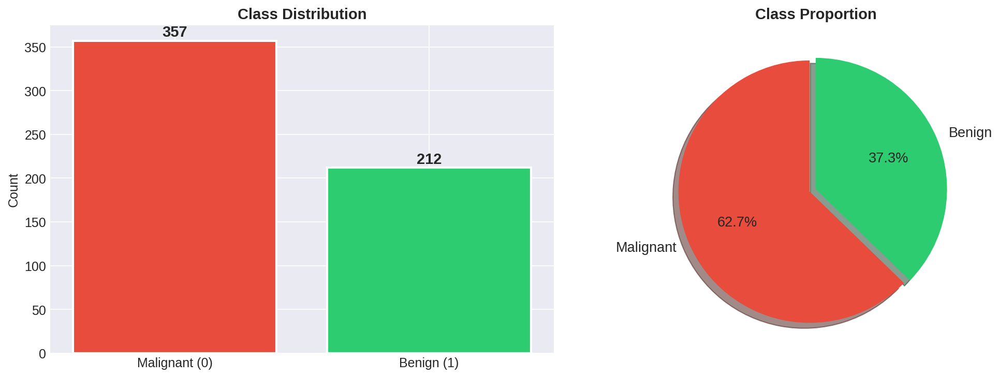
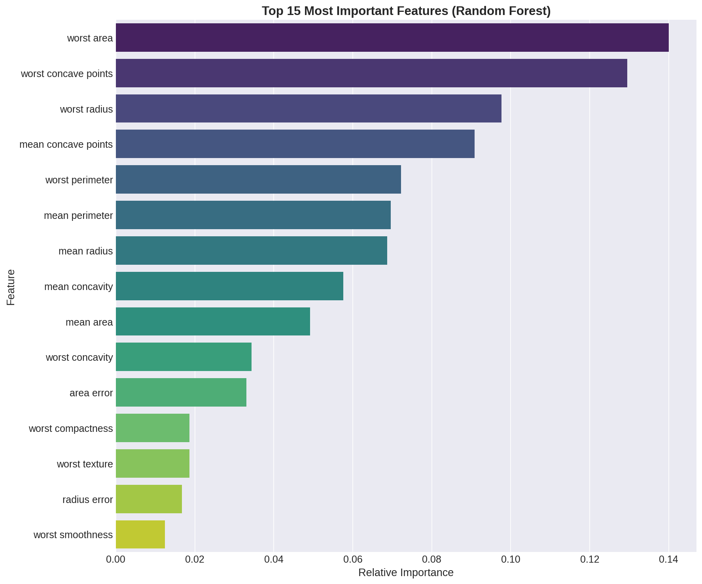
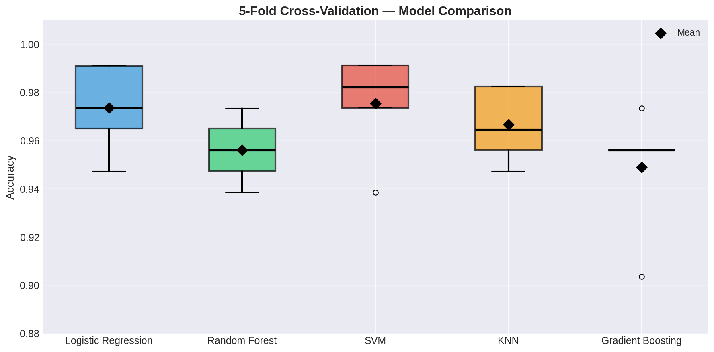
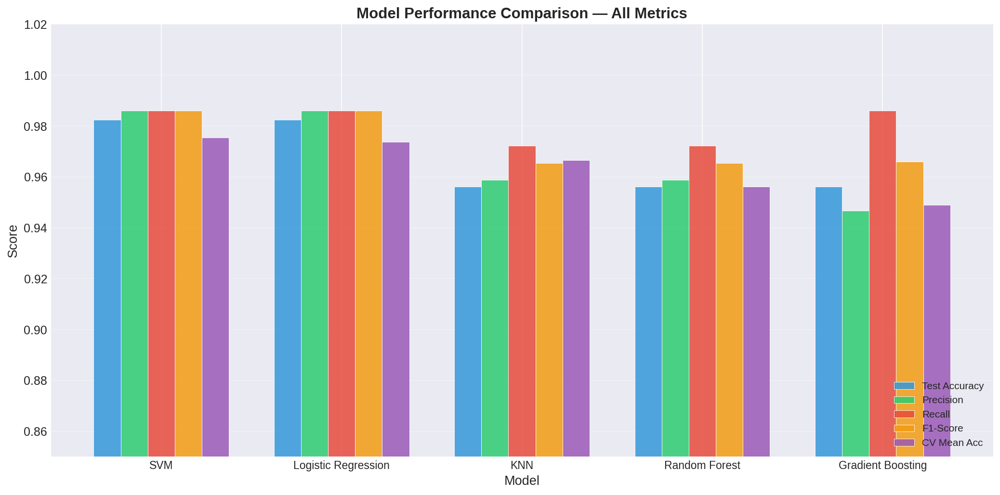

<div align="center">

# 🧬 Breast Cancer Prediction Engine

### Machine Learning-Powered Diagnostic Classification System

[](https://python.org)
[](https://scikit-learn.org)
[](https://pandas.pydata.org)
[](https://jupyter.org)
[](LICENSE)

*An end-to-end machine learning pipeline that classifies breast tumors as **benign** or **malignant** with **98.25% accuracy**, comparing 5 models with comprehensive evaluation metrics.*

---

[Features](#-features) · [Models](#-models-trained) · [Results](#-results) · [Getting Started](#-getting-started) · [Project Structure](#-project-structure)

</div>

---

## 🎯 Problem Statement

Breast cancer is one of the most common cancers affecting women globally. Traditional diagnostic methods rely on subjective visual inspections, which can lead to diagnostic errors. Research shows that machine learning can improve diagnostic accuracy from **79.97%** (experienced physicians) to over **91%** — providing a critical second opinion for clinicians.

This project builds a **binary classification system** that predicts whether a breast tumor is:

| Class | Label | Description |
|:-----:|:-----:|:------------|
| `0` | **Malignant** | Cancerous — requires immediate medical intervention |
| `1` | **Benign** | Non-cancerous — lower immediate risk |

---

## ✨ Features

- 🔬 **Data Exploration & Profiling** — Statistical analysis of 30 tumor characteristics
- 📊 **Visual Analytics** — Pair plots, correlation heatmaps, class distribution charts
- 🧹 **Data Preprocessing** — Feature normalization with StandardScaler, stratified train/test splitting
- 🤖 **5 ML Models** — Logistic Regression, Random Forest, SVM, KNN, Gradient Boosting
- 📈 **Comprehensive Evaluation** — Confusion matrices, ROC-AUC curves, precision-recall curves, classification reports
- 🔄 **Cross-Validation** — 5-fold stratified CV for robust performance estimation

---

## 🧠 Models Trained

| # | Model | Type | Key Strength |
|:-:|:------|:-----|:-------------|
| 1 | **Logistic Regression** | Linear | Interpretable, fast, strong baseline |
| 2 | **Random Forest** | Ensemble | Handles non-linear patterns, feature importance |
| 3 | **Support Vector Machine** | Kernel-based | Effective in high-dimensional spaces |
| 4 | **K-Nearest Neighbors** | Instance-based | No training phase, intuitive |
| 5 | **Gradient Boosting** | Boosted Ensemble | Sequential error correction |

---

## 📊 Dataset

**Source:** [Breast Cancer Wisconsin (Diagnostic) Dataset](https://www.kaggle.com/c/breast-cancer-classification) — UCI Machine Learning Repository via Kaggle

| Property | Value |
|:---------|:------|
| Samples | 569 |
| Features | 30 numeric predictive attributes |
| Classes | 2 (Malignant / Benign) |
| Missing Values | None |

### Key Features

The dataset describes characteristics of cell nuclei present in digitized images of fine needle aspirate (FNA) of breast masses:

- **Geometry** — radius, perimeter, area, compactness, concavity
- **Texture** — texture, smoothness, symmetry, fractal dimension
- Each feature has **mean**, **standard error**, and **worst** (largest) values

### Data Visualization

<div align="center">

| Class Distribution | Feature Correlation |
|:-:|:-:|
|  |  |

| Feature Pair Plot |
|:-:|
|  |

</div>

---

### Advanced Feature Engineering

<div align="center">

| PCA (2D Projection) | Feature Importance |
|:-:|:-:|
|  |  |

| Outlier Detection (Top 5 Features) |
|:-:|
|  |

</div>

---

## 🏆 Results

### Model Comparison Leaderboard

| Model | Test Accuracy | Precision | Recall | F1-Score | AUC |
|:------|:------------:|:---------:|:------:|:--------:|:---:|
| **🥇 Logistic Regression** | **98.25%** | 98.61% | 98.61% | 98.61% | 0.9954 |
| **🥇 SVM** | **98.25%** | 98.61% | 98.61% | 98.61% | 0.9950 |
| Random Forest | 95.61% | 95.89% | 97.22% | 96.55% | 0.9939 |
| KNN | 95.61% | 95.89% | 97.22% | 96.55% | 0.9788 |
| Gradient Boosting | 95.61% | 94.67% | 98.61% | 96.60% | 0.9907 |

### Confusion Matrices

<div align="center">


</div>

### ROC-AUC Curves

<div align="center">


</div>

### Precision-Recall Curves

<div align="center">


</div>

### Cross-Validation (5-Fold Stratified)

<div align="center">



</div>

### Model Performance Comparison

<div align="center">



</div>

> **Key Insight:** Logistic Regression and SVM achieve the highest test accuracy (98.25%) with only 1 false positive and 1 false negative each. The high recall across all models makes them suitable as computer-aided diagnostic tools where minimizing missed cancers is critical.

---

## 🚀 Getting Started

### Prerequisites

- Python 3.10 or higher
- pip (Python package manager)

### Installation

```bash
# Clone the repository
git clone https://github.com/game-ale/Breast_Cancer_Prediction_Engine.git
cd Breast_Cancer_Prediction_Engine

# Create a virtual environment (recommended)
python -m venv venv
source venv/bin/activate  # On Windows: venv\Scripts\activate

# Install dependencies
pip install -r requirements.txt
```

### Run the Notebook

```bash
jupyter notebook notebooks/breast_cancer_prediction.ipynb
```

### Run the Web App (Streamlit)

```bash
streamlit run app.py
```

---

## 📁 Project Structure

```
Breast_Cancer_Prediction_Engine/
├── 📓 notebooks/
│   └── breast_cancer_prediction.ipynb   # Full ML pipeline (33 cells)
├── 📊 data/
│   └── data.csv                         # Wisconsin Diagnostic Dataset
├── 🖼️ images/
│   ├── class_distribution.png           # Benign vs Malignant distribution
│   ├── correlation_heatmap.png          # Feature correlation matrix
│   ├── pairplot.png                     # Feature pair plot
│   ├── confusion_matrices.png           # All 5 model confusion matrices
│   ├── roc_curves.png                   # ROC-AUC comparison
│   ├── precision_recall_curves.png      # PR curve comparison
│   ├── cross_validation.png             # 5-fold CV box plot
│   └── model_comparison.png             # Final metric comparison
├── 📋 requirements.txt                  # Python dependencies
├── 📄 LICENSE                           # MIT License
├── 🚫 .gitignore                        # Git ignore rules
└── 📖 README.md                         # Project documentation
```

---

## 🛠️ Tech Stack

| Technology | Purpose |
|:-----------|:--------|
| **NumPy** | Numerical computation |
| **Pandas** | Data manipulation & analysis |
| **Scikit-Learn** | ML models, metrics, preprocessing |
| **Seaborn** | Statistical data visualization |
| **Matplotlib** | Plotting & charting |
| **Streamlit** | Web application framework |

---

## 📐 Methodology

```
┌──────────────┐    ┌──────────────┐    ┌──────────────┐    ┌──────────────┐    ┌──────────────┐
│   Data Load  │───▶│  Preprocess  │───▶│  Train 5     │───▶│  Evaluate    │───▶│   Compare    │
│  & Explore   │    │  & Scale     │    │  Models      │    │  Each Model  │    │  & Rank      │
└──────────────┘    └──────────────┘    └──────────────┘    └──────────────┘    └──────────────┘
     ▼                    ▼                    ▼                    ▼                    ▼
 • Load CSV          • StandardScaler    • LogReg           • Confusion Matrix   • Leaderboard
 • Shape & info      • Stratified        • Random Forest    • Classification     • Bar chart
 • Statistics          80/20 split       • SVM                Report             • Best model
 • Pair plots        • Feature scale     • KNN              • ROC-AUC curve        selection
 • Correlation                           • Grad Boost       • PR curve
                                                            • 5-Fold CV
```

---

## 🔮 Future Improvements

- [ ] Build a Streamlit web app for interactive predictions
- [ ] Add PCA visualization (2D/3D)
- [ ] Feature importance ranking with Random Forest
- [ ] Hyperparameter tuning with GridSearchCV
- [ ] Docker containerization & cloud deployment

---

## 📜 License

This project is licensed under the MIT License — see the [LICENSE](LICENSE) file for details.

---

## 🙏 Acknowledgments

- **Dataset**: [UCI Machine Learning Repository](https://archive.ics.uci.edu/ml/datasets/Breast+Cancer+Wisconsin+(Diagnostic)) via Kaggle
- **Inspiration**: Research on computer-aided diagnosis systems for breast cancer detection

---

<div align="center">

**⭐ If you found this project useful, please consider giving it a star!**

Made with ❤️ by [Gemechu](https://github.com/game-ale)

</div>
